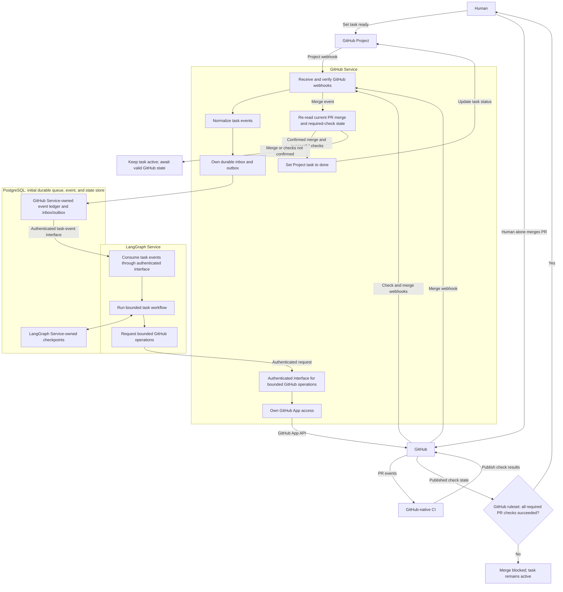

# LangGraph Multi-Repo Task Platform on Kubernetes

## 1. Problem framing

The goal is not to build a single autonomous coding assistant. The goal is to build a managed engineering platform that can accept work from GitHub issues, route that work to the right repository and execution context, coordinate a bounded workflow, and return a validated result with clear human oversight.

A GitHub issue is rarely just a patch. It often combines context gathering, root-cause analysis, implementation, validation, documentation, and status updates. In a multi-repository environment, those tasks become even more complex because the platform must handle repository boundaries, differing toolchains, varying ownership models, and different risk profiles.

The architecture therefore centers on three ideas:

- a multi-repository task platform rather than a single-repo bot,
- a graph-based orchestration layer with explicit state transitions, policy controls, and an auditable PR lifecycle,
- a Kubernetes execution model that isolates work, scales safely, and keeps operational control in the platform rather than in the model.

## 2. Design decisions we settled on

### 2.1 Multi-repo task platform

The platform is designed for many repositories, not one. Each task belongs to exactly one repository, which may be a monorepo. A single task does not coordinate changes across repositories. Work is modeled as tasks with metadata such as:

- exactly one target repository (which may be a monorepo),
- issue or ticket source,
- repository-defined validation requirements and result sources,
- risk level,
- ownership or reviewer hints,
- expected completion state.

The system treats repository context as first-class data. A task can be routed to its repository's codebase, build environment, and validation path without hard-coding one repo into the orchestrator. This allows the same workflow engine to operate across multiple projects while preserving repo-specific policies.

### 2.2 Specialized, bounded workers

We are not using a single general-purpose agent to “do everything.” Instead, the platform is composed of specialized workers with narrow responsibilities. Examples include:

- issue intake and normalization,
- repo context and dependency discovery,
- patch generation and refactoring,
- GitHub-native CI result intake and validation evidence review,
- PR description and release-note preparation,
- documentation maintenance for confirmed design decisions,
- review and risk triage.

Each worker has bounded inputs, bounded outputs, and a clear contract. This reduces drift, makes retries easier to reason about, and improves observability. The orchestrator remains in charge of sequencing work; the workers do the requested execution within a specific contract.
Each worker has bounded inputs, bounded outputs, and a clear contract. This reduces drift, makes retries easier to reason about, and improves observability. LangGraph's responsibility is limited to producing a PR through bounded repository and GitHub operations. It must not run or invoke external commands, including arbitrary shell or process execution.

The documentation worker is a narrow maintainer and governance role: it records already-resolved and confirmed design decisions in the architecture documentation and relevant README summaries, and returns a concise change summary and any open questions. It must not invent decisions or publish intermediate thoughts.

### 2.3 Model-to-role routing

The system does not use one model for every job. Instead, models are assigned by role based on task characteristics:

- small, low-cost models for classification, triage, and metadata extraction,
- reasoning-oriented models for planning, root-cause analysis, and architecture decisions,
- code-focused models for patch generation and refactoring,
- validation or review models for checking correctness, regression risk, and summary quality.

This allows a task to use the cheapest model that can safely do the job while reserving more expensive reasoning models for decisions where depth matters. Routing is explicit and policy-driven, not ad hoc.

### 2.4 Hybrid worker pools

The execution model is hybrid:

- long-lived services handle orchestration, queueing, and workflow state,
- bounded workers support repository context gathering, patch preparation, and PR production,
- GitHub-native CI may run repository-configured checks in response to repository or project events, independently of LangGraph,
- humans initiate the normal workflow by setting a GitHub Project task to `ready` and authorize completion by merging its PR only after CI succeeds.

This combination gives us both responsiveness and operational control. Long-lived services keep the graph responsive, while isolated short-lived jobs keep the platform resilient and easier to scale.

### 2.5 Human authorization and risk policy

The Phase 1 task flow has two human gates: a human moves the GitHub Project task to the configured start status (default `Ready`), which triggers workflow intake, and later validates the PR by merging it. The bundled LangGraph operations use an internal llama.cpp `/completion` provider for bounded source-path selection, structured planning, an advisory risk summary, and typed file changes. GitHub Service derives repository and installation only from immutable task context, validates selected files against that task's current base tree, and independently validates proposals before applying them to the deterministic task branch. It never merges or writes the base branch. Risk output is advisory and does not add a gate. All GitHub-native CI checks for a PR must report success before human merge; pending, unavailable, errored, or failed checks block merge, with no human override. A successful merge automatically sets the task to `done`. The workflow does not require a separate GitHub review-approval event; if repository policy requires formal approvals, configure that independently in GitHub branch protection.

Phase 2 adds an explicit rework gate: when the human requests changes instead of merging, they comment `/agent <prompt>` on the PR. The workflow updates that PR's task branch, GitHub-native CI reruns, and the human reviews the updated PR. This loop may repeat until the human merges. The command must not authorize merging or writes to the target branch, and ordinary PR comments must not trigger edits. Authorization policy for who may invoke `/agent` must be enforced before Phase 2 is enabled.

Risk identification and initial classification belong to the workflow; the human reviews the surfaced risks and owns the merge decision. The exact risk scoring or classification method remains unspecified. Each task should include validation results, a scope summary, a PR risk summary, and an audit trail.

### 2.6 LangGraph tools instead of first-class skills

The orchestration layer uses LangGraph tools as the interface for bounded PR-producing operations, not “first-class skills” as a separate abstraction. In practice, this means:

- tools are the callable contract between the graph and the runtime,
- each tool exposes a defined schema, side effects, timeout, retry conditions, and return format,
- each tool exposes a defined schema, side effects, timeout, retry conditions, and return format; tools must not run or invoke external commands,
- the graph can compose tools into stateful workflows without baking agent behavior into a rigid skill taxonomy,
- PR production remains portable and inspectable because the graph operates on structured tool calls, not hidden capabilities.

This keeps the platform aligned with LangGraph’s orchestration model and avoids building a parallel conceptual layer that duplicates tool interfaces. The graph orchestrates workflows; tools perform the concrete repository actions.
This keeps the platform aligned with LangGraph’s orchestration model and avoids building a parallel conceptual layer that duplicates tool interfaces. The graph orchestrates bounded repository and GitHub operations needed to produce a PR; it does not launch external commands.

### 2.7 Revised Kubernetes deployment model

The earlier view assumed a more general-purpose cloud deployment. The settled model is more explicit:

- the orchestrator runs as a long-lived service,
- workflow state and task metadata live in persistent stores,
- queue and scheduling services handle task fan-out,
- bounded services and workloads support repository context gathering and PR production,
- GitHub-native CI runs repository checks in response to GitHub events; successful PR checks are required for merge and are not commands launched by LangGraph,
- worker pools are separated by function, not collapsed into one generic execution namespace,
- runtime access is scoped by repository, environment, and policy.

The result is a platform architecture where the graph is the control plane and Kubernetes is the execution substrate. The model is not “one big agent pod.” It is a set of coordinated services with distinct responsibilities and access boundaries.
The result is a platform architecture where the graph is the control plane and Kubernetes supports isolated platform workloads. This does not grant LangGraph or its workers broad command-execution permission.

## 3. Runtime architecture

The platform can be reasoned about as four layers:

1. Event and intake layer
   - GitHub issue events, project updates, PR events, and task creation sources
   - canonical task creation and routing logic
   - backlog and queueing for work submission

2. Orchestration layer
   - LangGraph workflow state machine
   - task lifecycle management
   - branching, retries, and risk-policy controls
   - evidence collection for traceability

3. PR production layer
   - bounded repository context and patch preparation
   - PR creation and update operations
   - GitHub-native CI result intake for the required PR merge gate

4. Platform services and control plane
   - secrets and identity management
   - Kubernetes scheduling and runtime isolation
   - monitoring, logs, and trace correlation
   - audit records and state persistence

A simplified task flow is:
GitHub-native CI runs configured checks only in response to the relevant GitHub events; LangGraph does not launch those commands. All PR CI checks must report success before merge; unavailable, pending, errored, or failed checks block merge.

Phase 1 target: human sets task to configured start status (default `Ready`) -> LangGraph selects bounded source context and creates a typed proposal with the internal local model -> GitHub Service applies it to the task branch and opens/reuses its PR -> GitHub-native CI reports required checks -> human validates by merging -> successful merge sets task to `Done`.

Phase 2 rework loop: human comments `/agent <prompt>` -> workflow updates the same PR branch -> GitHub-native CI reruns -> human reviews again; repeat as needed, then merge only after required checks succeed.

## 4. Workflow structure

The graph should be explicit and bounded. The platform should not rely on one unrestricted “agent loop.” Instead, a typical workflow runs as a structured set of states.

### 4.1 Intake and normalization

- A human moves the GitHub Project task to the configured start status (default `Ready`); that transition triggers workflow intake. GitHub-native CI is a separate PR validation step, not the intake trigger.
- Parse issue text, acceptance criteria, labels, and repository hints.
- Determine scope, risk, and requested outcome.
- Identify all repository-defined PR checks and how their results are reported; missing or unavailable results must not be treated as success.
- During Phase 2, if the workflow cannot safely proceed because the issue lacks precision, an agent may post a focused question as a comment on the linked GitHub issue and pause that task. Record the question and response in the task audit trail. Resume the same task only when an authorized human replies on that issue while clarification is pending; the reply supplies context and does not itself authorize a code change or merge.
- Treat clarification as exceptional, not as a routine approval checkpoint. Phase 1's human gates are setting the task to the configured start status and merging the PR; Phase 2 adds `/agent <prompt>` on the PR for rework and issue comments for clarification. Clarification timeout and commenter authorization policy must be defined before Phase 2 is enabled.

The output is a normalized task definition with an initial risk assessment and execution constraints. The exact risk scoring or classification method is unspecified.

### 4.2 Context and repo assembly

- Identify the task's single target repository and relevant code paths within it.
- Gather issue history, prior PRs, related tests, and ownership metadata.
- Build a minimal context package for planning.

This stage reduces the chance of wrong patch generation by grounding the execution in the actual repo structure.

### 4.3 Planning and decomposition

- Convert the issue into a concrete engineering plan.
- Break the task into implementable steps.
- Identify assumptions, unknowns, and validation plan.

The plan should be structured and machine-readable so the graph can route work, apply risk-policy controls, and decide which workers are needed.

### 4.4 Execution

- A configured provider may prepare a focused typed file-change proposal. GitHub Service validates it, applies it to the deterministic task branch, and creates or reuses the matching PR.
- Do not run or invoke external commands, including shell commands or child processes.

The authenticated proposal API accepts only `task_id` and up to 20 create/update changes (64 KiB per file, 256 KiB total, and a 2 MiB raw JSON request limit). It rejects traversal, absolute paths, backslashes, controls, duplicate/case-colliding paths, and narrow credential/private-key filenames. Repository identity comes only from immutable GitHub-owned task context; current Project status, archive state, and issue state are re-read before writes. The base is the repository's current default branch, and the task branch name is deterministic from the task ID. Git Data commits use the current parent and update refs with `force: false`; repeated identical proposals create no extra commit, and a task reuses only a PR verified against the repository, task branch, and base. The code does not merge or update the base branch.

The bundled operations obtain candidate paths and selected text files through the authenticated GitHub Service API, then use the local llama.cpp provider to produce the plan, advisory risk summary, and typed changes. The retrieved files establish a trusted task scope: updates are limited to those exact paths, while creates are limited to their immediate parent directories. Model-proposed paths are checked against this scope before the proposal is sent to GitHub Service. On CI failure, repair uses the recorded failures and the same task context and scope before submitting through this authenticated proposal API. The provider does not receive GitHub credentials or installation identifiers. The source API never accepts repository names from LangGraph or the model, and it rejects unsafe paths, sensitive directory components (case-insensitively, including `secrets`, `.ssh`, `.aws`, `.azure`, and credential directories), symlinks, submodules, binary files, secret-like content, incomplete trees, oversized files, and timed-out reads.

The LangGraph worker probes the local llama.cpp `/health` endpoint with a two-second timeout before claiming queue work. While inference is unavailable, the worker defers polling without claiming events or incrementing their attempt count. `/readyz` reports HTTP 503 with `dependency: local_model`; `/healthz` remains a liveness check.

### 4.5 Validation gate

- GitHub-native CI may run repository-configured checks when triggered by repository or project events. This is distinct from a command launched by LangGraph, which is not permitted.
- Record PR CI results from GitHub; do not assume broad worker command-execution permission.
- Every GitHub-native CI check for the PR must report success before merge. Pending, unavailable, errored, or failed checks block merge, and no human override is permitted.
- If a check fails or errors, route back to a repair or replanning node with the available details. Do not treat validation evidence alone, or the absence of a result, as permission to merge.

The task cannot reach `done` through its PR unless that PR is merged, and the PR cannot be merged until all its CI checks report success.

### 4.6 Risk safeguards

LangGraph may propose a patch and produce a PR, but it cannot merge the PR or directly change the target branch. This limits automation authority, not the potential impact of the proposed patch. The PR must surface a risk summary so the human can double-check potential impacts before deciding whether to merge. The human merge is the authorization and completion gate, and all PR CI checks must succeed first; this is a hard requirement, not a human-override gate. No separate routine or high-risk human approval gate is defined. The exact risk scoring or classification method remains unspecified.

### 4.7 Documentation maintenance

After a major design decision is resolved and confirmed, route the confirmed decision to the documentation worker. The worker refreshes the architecture documentation and relevant README summary, records a concise change summary and open questions, and the task is marked documented before completion.

### 4.8 Completion and reporting

- Open or update the PR on GitHub with a risk summary of potential impacts, and record its GitHub-native CI results.
- A human may merge the PR only after all PR CI checks report success; successful merge automatically sets the GitHub Project task to `done`.
- Record the final state and any follow-up recommendations.

The platform should preserve an audit trail so the result is reviewable later.

### 4.9 Phase 2 PR revision workflow

Phase 2 uses an explicit GitHub PR comment command: `/agent <prompt>`. It asks the workflow to make a bounded revision to the existing PR, not to start an unrelated task or open a replacement PR. If the task lacks precision, the agent may instead post a focused question on the linked issue and pause the task until an authorized human replies there. A reply is accepted only for that pending clarification; other issue comments do not trigger work. After clarification, the workflow resumes the same task and updates the same task branch and PR; GitHub-native CI reruns, and the human reviews the updated PR. The human may repeat this loop, then validates by merging only after all required checks succeed. LangGraph and its workers do not merge PRs or write to the target branch.

Phase 2 is a planned capability, not implemented in the current services. Subscribe the GitHub App to `issue_comment` events for the target repository. Before enabling it, enforce an authorization policy for `/agent` commenters and clarification responders, correlate replies to a pending task, and define limits for prompt scope, retry count, and handling of requests outside the original task. These controls must not change the human merge gate or the required-check policy.

If implemented, Phase 2's bounded patch may reuse this same authenticated proposal API and verified task branch/PR path. The `/agent` command, commenter authorization, rework semantics, and clarification flow remain planned and are not implemented here.

### 4.10 Custom GitHub App assignment-trigger hypothesis (under evaluation)

#### Hypothesis only

A custom GitHub App bot integrated with a target repository may become part of the task flow. One possible alternative intake trigger is a human assigning a GitHub issue to the App bot identity. This is a hypothesis, not an accepted architecture decision. Until a proof of concept (POC) is completed, evaluated, and explicitly approved, the current baseline remains unchanged: a human sets the GitHub Project task to `ready` to trigger CI/workflow intake. Assignment to a bot does not currently trigger the documented flow.

#### POC questions and acceptance criteria

The POC must use the intended GitHub App installation and target repository, and report evidence for each question:

- Can a human assign an issue to the actual GitHub App bot identity in the target repository? Record any repository or organization prerequisites and the identity shown on the issue.
- Does the `issues.assigned` webhook arrive for that assignment through the intended App installation, with enough information to identify the repository, issue, and assignee reliably?
- What is the least-privilege permission set needed to observe the assignment, read required issue context, and produce a PR? Verify the required grants in the POC; do not assume broad repository or organization permissions.
- Can a constrained App produce a PR for the task using bounded GitHub operations without LangGraph invoking external commands? Record the App's effective authority and confirm that it cannot merge the PR or directly change the target branch.
- Does the resulting PR continue through GitHub-native CI, with every required check reporting success as a merge prerequisite and a human as the only actor authorized to merge?

The POC is complete only when these questions have documented results, including failures, limitations, and the permissions actually required. The result informs whether the App integration and assignment trigger should be proposed for inclusion in the flow; it does not itself change the architecture.

#### Settled decisions that remain in force

This evaluation does not revise the settled `ready`-trigger baseline. It also does not change the existing requirements that LangGraph must not run or invoke external commands, GitHub-native PR checks must all succeed before merge, and only a human may merge a PR. Any future inclusion of the App integration or assignment trigger requires a separate explicit decision after the POC is evaluated.

## 5. Security and governance

The platform’s trust model depends on explicit guardrails.

### 5.1 Identity and repository boundaries

- Use granular GitHub App permissions minimized to the minimum necessary for the defined PR workflow and task context; do not grant excessive access.
- Before enabling source context and proposals, the App uses `Contents: Read` for candidate-tree and file reads and needs effective repository `Contents: Read and write` (which includes read) for Git Data objects and task-branch refs; also grant `Pull requests: Read and write`, `Issues: Read`, and `Projects: Read` for the configured Project owner. Repository metadata read is required and included by GitHub as a baseline permission. These are deployment prerequisites only; repository configuration does not prove that the installed App has these grants or selected-repository access. Verify the actual installation in GitHub before use. Do not grant a ruleset or branch-protection bypass; the base branch is never written by this service.
- GitHub App installation and grants of selected-repository access across organizations are managed by GitHub's native organization and repository administration. The platform consumes the access granted to the App; it does not independently authorize organization installation or grant repository access.
- Separate service accounts for orchestration, execution, and validation.
- Treat GitHub App credentials as operationally sensitive and rotate them according to policy.

The GitHub service is configured with the App ID and target Project owner login,
owner kind, and Project number. It resolves the Project node, status field, and
status option IDs by their configured names through GraphQL and fails closed on
missing or ambiguous results. Each signed webhook must provide a positive
installation ID; the service persists it immutably with task context and uses
that installation for later PR, check, and completion calls. No static
installation ID or opaque Project/field/option IDs are configuration.

### 5.2 Runtime isolation

- Run bounded repository-context and PR-production workloads in isolated Kubernetes environments.
- Default to network restrictions and least-privilege egress.
- Do not infer broad command-execution permission for workers from the Kubernetes execution model.
- Protect the cluster from direct worker access to privileged credentials.

### 5.3 Human authorization and risk policy in practice

The workflow can produce a PR but cannot merge it or directly change the target branch; this limited authority does not imply that a proposed patch has no security, data, infrastructure, production, or customer-facing impact. The PR includes a risk summary for the human to double-check. The human decides whether to merge, but only after all PR CI checks report success; pending, unavailable, errored, or failed checks block merge without override. A successful merge authorizes completion and automatically sets the task to `done`. No separate routine or high-risk human approval gate is defined. The exact risk scoring or classification method remains unspecified.

### 5.4 Auditability

Every task should produce:

- a task record,
- graph state transitions,
- tool call inputs and outputs,
- available GitHub-native CI results and validation evidence,
- the PR risk summary and identified potential impacts,
- PR and merge events, including the resulting project status.

This ensures the platform remains inspectable even when work is largely automated.

## 6. Kubernetes deployment model

The deployment model is intentionally modular.

### 6.1 Core components

- orchestrator service: long-lived LangGraph API / control service,
- task queue: durable queue for task intake and fan-out,
- bounded workers: repository context, patch preparation, and PR production,
- GitHub-native CI: repository checks triggered by GitHub events, required to succeed before PR merge and independent of LangGraph command execution,
- data services: state storage, logs, traces, and artifact retention,
- ingress and auth layer: secure, rate-limited entrypoints.

### 6.2 Resource and lifecycle boundaries

- Keep the orchestration service stateless or minimally stateful with durable workflow backend support.
- Keep PR-production workloads bounded and separate from the stable control plane.
- Segment worker pools by capability and risk profile.
- Keep bursty workloads separate from the stable control plane.
- For the current lab deployment on `k8s-node01`, the storage requirement is general platform data on SSD and inference model artifacts on NVMe. This is specific to the lab deployment, not a general requirement for inference deployments; storage choices depend on the target environment. This is a placement requirement, not a verified Kubernetes mapping: cluster inspection found no accessible PV, PVC, or StorageClass, and the previously referenced `pv/inference-models` has not been confirmed usable.

### 6.3 llama.cpp inference deployment requirements (proposed)

This is a design and operator-runbook requirement, not an implemented or tested deployment procedure. No Kubernetes manifests, verified storage mapping, or successful deployment results are asserted here. Deployment artifacts and the operator runbook must be kept in version control and shared through the repository and its branch; do not rely on undocumented, ad hoc node commands.

Before deployment, the runbook and checked-in configuration must identify and verify:

- The serving image by immutable digest, with its source/build provenance recorded. Verify that the image's CUDA build supports NVIDIA Pascal `sm_61` and the P40 before use; do not infer compatibility from a generic CUDA label.
- The model artifact by immutable upstream revision and checksum, with its format, source and applicable license recorded, plus the required context-length and quantization settings.
- For `k8s-node01`, the actual PV/PVC and workload mount mapping that places model artifacts on NVMe and ordinary platform storage on SSD. Confirm the node's available storage resources and the mapping, capacity, and access before deployment; do not invent resource names or filesystem paths. Other inference environments may use different storage arrangements.
- One-time prerequisites and artifact/storage preparation, documented separately from application deployment. Record expected verification for preparation; keep runtime deployment declarative using checked-in Kubernetes manifests or the repository's established deployment convention so operators can reproduce it.

For each deployment, record observed validation results rather than assumed success: GPU allocation and in-container visibility, successful model load, memory use and fit for the pinned model/settings, and service connectivity. Include the node/environment, image digest, model revision and checksum, actual storage resource/mount mapping, and pass/fail evidence. Commands and paths that have not been verified must not be presented as working instructions.

### 6.4 Failure and recovery model

The platform should support resumable graph state and bounded retries. Failures are expected, but they should be isolated and visible:

- workflow state is persisted after each stage,
- retries are limited and policy-aware,
- PR-production tool failures may trigger a controlled retry or escalation,
- persistent errors surface with enough context for operators to intervene.

### 6.5 Implemented service and persistence boundaries

The runnable implementation uses two services with the existing package names:

| Service | Entrypoint | Owns |
| --- | --- | --- |
| GitHub service | `uvicorn github_service.host:create_app --factory` | Public signed webhooks, GitHub App credentials and API calls, event normalization, delivery ledger, durable event inbox/outbox, task-to-PR mappings, Project completion writes |
| LangGraph service | `uvicorn langgraph_service.host:create_app --factory` | Durable event consumption, graph execution, task lifecycle, and LangGraph checkpoints |

The GitHub service returns after normalized events are committed. The LangGraph worker claims outbox rows in PostgreSQL using `FOR UPDATE SKIP LOCKED`, a bounded lease, an attempt counter, and delayed retries that eventually dead-letter. A unique delivery-and-event ordinal makes webhook replays idempotent at enqueue time. Queue delivery is at least once, so injected operations must tolerate retry; proposal retries reuse the deterministic task branch and verified task PR, and identical file content creates no extra commit. There is no Redis or Kafka queue by default.

All three Kubernetes overlays bundle the same internal PostgreSQL StatefulSet with a 10Gi `ReadWriteOnce` PVC that uses the default StorageClass. The `github_service` schema contains webhook deliveries, normalized inbox rows, outbox state, task context, and PR mappings. The separate `langgraph_service` schema contains LangGraph checkpoints. Service logins inherit their matching `NOLOGIN` runtime roles; the migration Job temporarily grants schema creation to the LangGraph runtime role for `PostgresSaver.setup()`, then revokes it before completion.

The `codefactory-database-migrations` Job copies the SQL migration files from their owning service images, applies them idempotently, and invokes LangGraph checkpoint setup with the LangGraph login. Both Deployments wait for the migration-created tables before starting. Checkpoint setup therefore does not run during application startup. Recreate the completed Job before applying a release that introduces migrations. Database host, port, database, usernames, and `sslmode=disable` are shared internal defaults; only passwords are Secret values. SQLite remains available through the local `create_app` factory and tests only. No cluster or database changes are part of repository validation.

The LangGraph-to-GitHub API is bearer-authenticated. Its bounded capabilities are queue claim/ack/retry, typed file-change proposals, and task completion. GitHub Service alone derives repository and Project context from GitHub-owned records, applies proposals to its deterministic task branch, and creates or reuses the verified PR. LangGraph cannot choose repository/base/head/PR identity, call the GitHub App directly, merge, write branches, or run shell/process commands. The GitHub service re-fetches the matching PR and current check/status results after a merge webhook and writes `done` only when the PR is closed and merged and all returned checks are successful. GitHub branch/ruleset configuration remains responsible for blocking human merge until every repository-required check succeeds; configure and verify that separately.

SQLite and mocked-connection tests validate local behavior and PostgreSQL claim SQL, not a live PostgreSQL server. Operators provide the PostgreSQL admin and service passwords, webhook secret, internal token, GitHub App private key and App ID, and Project configuration. The installation ID comes from the signed webhook and is persisted with task context; it is not an operator-configured fallback. The Project node ID is derived from the resolved webhook item. The external HTTPS Ingress remains a platform responsibility: choose its hostname, TLS certificate/secret policy, and Ingress class, then configure the matching GitHub App webhook URL. The bundled `langgraph_service.workflow_operations` factory uses the local llama.cpp `/completion` provider and authenticated task-scoped source APIs. Configure `LLAMA_CPP_URL` to the internal inference service; the default is `http://llama-cpp-server.inference.svc.cluster.local:8080`. Install the inference deployment and model artifacts, verify model load and service readiness, and only then enable Codefactory task intake. The inference/GPU workload is deployed separately and is not included in Codefactory overlays. The required App grants remain an external deployment prerequisite. No cloud provider or workload sizing is bundled or implied.

## 7. Observability and operations

The platform should be observable across task intake, model routing, PR production, GitHub-native CI results, PR activity, and task status transitions.

Track:

- tasks received by repo and type,
- routing decisions by model and role,
- worker runtime and queue latency,
- PR-production runtime and queue latency,
- reported GitHub-native CI pass/fail results,
- retry counts and failure modes,
- ready-to-done task lifecycle outcomes.

This is essential to understand whether the system is optimizing for throughput, correctness, or safety, and to detect drift in tool or model behavior over time.

## 8. Recommendation

The correct architecture is not a monolithic coding agent. It is a managed multi-repo task platform with a disciplined LangGraph orchestration layer limited to PR production, bounded supporting workers, explicit model-to-role routing, GitHub-native CI triggered by GitHub events and required to succeed before PR merge, human authorization through PR merge, and potential risks summarized in each PR for human review.

In practice, this gives us the right balance:

- automation for routine engineering work,
- human review of surfaced risks before merge,
- traceability for every task,
- scalability across repositories and teams,
- operational safety through Kubernetes isolation and policy enforcement.

This model is consistent with the platform decisions we settled on and is the one best suited to real-world GitHub issue execution at scale.
