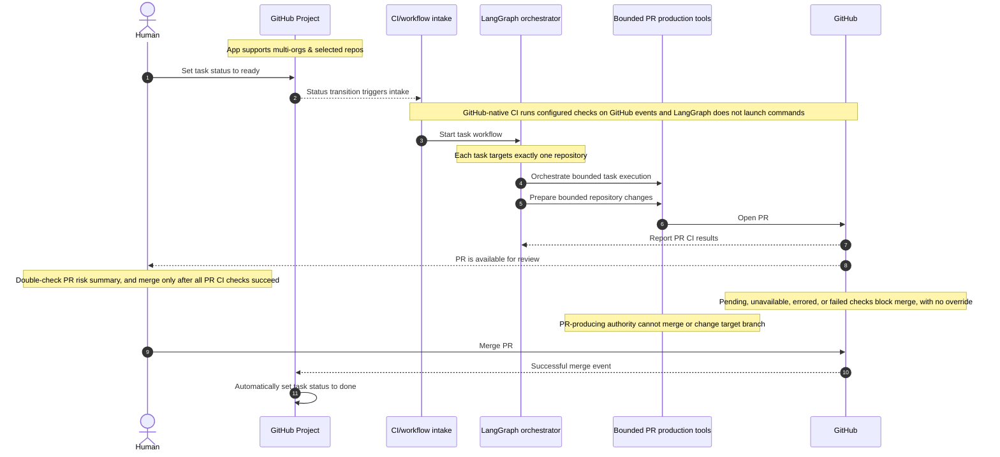

# LangGraph Multi-Repo Task Platform on Kubernetes

## 1. Problem framing

The goal is not to build a single autonomous coding assistant. The goal is to build a managed engineering platform that can accept work from GitHub issues, route that work to the right repository and execution context, coordinate a bounded workflow, and return a validated result with clear human oversight.

A GitHub issue is rarely just a patch. It often combines context gathering, root-cause analysis, implementation, validation, documentation, and status updates. In a multi-repository environment, those tasks become even more complex because the platform must handle repository boundaries, differing toolchains, varying ownership models, and different risk profiles.

The architecture therefore centers on three ideas:

- a multi-repository task platform rather than a single-repo bot,
- a graph-based orchestration layer with explicit state transitions, policy controls, and an auditable PR lifecycle,
- a Kubernetes execution model that isolates work, scales safely, and keeps operational control in the platform rather than in the model.

## 2. Design decisions we settled on

### 2.1 Multi-repo task platform

The platform is designed for many repositories, not one. Each task belongs to exactly one repository, which may be a monorepo. A single task does not coordinate changes across repositories. Work is modeled as tasks with metadata such as:

- exactly one target repository (which may be a monorepo),
- issue or ticket source,
- repository-defined validation requirements and result sources,
- risk level,
- ownership or reviewer hints,
- expected completion state.

The system treats repository context as first-class data. A task can be routed to its repository's codebase, build environment, and validation path without hard-coding one repo into the orchestrator. This allows the same workflow engine to operate across multiple projects while preserving repo-specific policies.

### 2.2 Specialized, bounded workers

We are not using a single general-purpose agent to “do everything.” Instead, the platform is composed of specialized workers with narrow responsibilities. Examples include:

- issue intake and normalization,
- repo context and dependency discovery,
- patch generation and refactoring,
- GitHub-native CI result intake and validation evidence review,
- PR description and release-note preparation,
- documentation maintenance for confirmed design decisions,
- review and risk triage.

Each worker has bounded inputs, bounded outputs, and a clear contract. This reduces drift, makes retries easier to reason about, and improves observability. The orchestrator remains in charge of sequencing work; the workers do the requested execution within a specific contract.
Each worker has bounded inputs, bounded outputs, and a clear contract. This reduces drift, makes retries easier to reason about, and improves observability. LangGraph's responsibility is limited to producing a PR through bounded repository and GitHub operations. It must not run or invoke external commands, including arbitrary shell or process execution.

The documentation worker is a narrow maintainer and governance role: it records already-resolved and confirmed design decisions in the architecture documentation and relevant README summaries, and returns a concise change summary and any open questions. It must not invent decisions or publish intermediate thoughts.

### 2.3 Model-to-role routing

The system does not use one model for every job. Instead, models are assigned by role based on task characteristics:

- small, low-cost models for classification, triage, and metadata extraction,
- reasoning-oriented models for planning, root-cause analysis, and architecture decisions,
- code-focused models for patch generation and refactoring,
- validation or review models for checking correctness, regression risk, and summary quality.

This allows a task to use the cheapest model that can safely do the job while reserving more expensive reasoning models for decisions where depth matters. Routing is explicit and policy-driven, not ad hoc.

### 2.4 Hybrid worker pools

The execution model is hybrid:

- long-lived services handle orchestration, queueing, and workflow state,
- bounded workers support repository context gathering, patch preparation, and PR production,
- GitHub-native CI may run repository-configured checks in response to repository or project events, independently of LangGraph,
- humans initiate the normal workflow by setting a GitHub Project task to `ready` and authorize completion by merging its PR only after CI succeeds.

This combination gives us both responsiveness and operational control. Long-lived services keep the graph responsive, while isolated short-lived jobs keep the platform resilient and easier to scale.

### 2.5 Human authorization and risk policy

The normal task flow has two human actions: set the GitHub Project task to `ready`, which triggers CI/workflow intake, and merge the resulting PR. LangGraph performs bounded work to produce a PR and may create or update its task branch, but it cannot merge the PR or directly change the target branch. The workflow identifies potential risks and summarizes them in the PR so the human can double-check the proposed patch before deciding whether to merge. Limited automation authority does not mean the proposed patch is risk-free; it may still have security, data, infrastructure, production, or customer-facing impact. All GitHub-native CI checks for the PR must report success before merge; pending, unavailable, errored, or failed checks block merge, with no human override. A successful merge automatically sets the task to `done`, so a PR blocked by CI cannot complete the task. There is no separate routine or high-risk human approval gate before PR creation or merge.

Risk identification and initial classification belong to the workflow; the human reviews the surfaced risks and owns the merge decision. The exact risk scoring or classification method remains unspecified. Each task should include validation results, a scope summary, a PR risk summary, and an audit trail.

### 2.6 LangGraph tools instead of first-class skills

The orchestration layer uses LangGraph tools as the interface for bounded PR-producing operations, not “first-class skills” as a separate abstraction. In practice, this means:

- tools are the callable contract between the graph and the runtime,
- each tool exposes a defined schema, side effects, timeout, retry conditions, and return format,
- each tool exposes a defined schema, side effects, timeout, retry conditions, and return format; tools must not run or invoke external commands,
- the graph can compose tools into stateful workflows without baking agent behavior into a rigid skill taxonomy,
- PR production remains portable and inspectable because the graph operates on structured tool calls, not hidden capabilities.

This keeps the platform aligned with LangGraph’s orchestration model and avoids building a parallel conceptual layer that duplicates tool interfaces. The graph orchestrates workflows; tools perform the concrete repository actions.
This keeps the platform aligned with LangGraph’s orchestration model and avoids building a parallel conceptual layer that duplicates tool interfaces. The graph orchestrates bounded repository and GitHub operations needed to produce a PR; it does not launch external commands.

### 2.7 Revised Kubernetes deployment model

The earlier view assumed a more general-purpose cloud deployment. The settled model is more explicit:

- the orchestrator runs as a long-lived service,
- workflow state and task metadata live in persistent stores,
- queue and scheduling services handle task fan-out,
- bounded services and workloads support repository context gathering and PR production,
- GitHub-native CI runs repository checks in response to GitHub events; successful PR checks are required for merge and are not commands launched by LangGraph,
- worker pools are separated by function, not collapsed into one generic execution namespace,
- runtime access is scoped by repository, environment, and policy.

The result is a platform architecture where the graph is the control plane and Kubernetes is the execution substrate. The model is not “one big agent pod.” It is a set of coordinated services with distinct responsibilities and access boundaries.
The result is a platform architecture where the graph is the control plane and Kubernetes supports isolated platform workloads. This does not grant LangGraph or its workers broad command-execution permission.

## 3. Runtime architecture

The platform can be reasoned about as four layers:

1. Event and intake layer
   - GitHub issue events, project updates, PR events, and task creation sources
   - canonical task creation and routing logic
   - backlog and queueing for work submission

2. Orchestration layer
   - LangGraph workflow state machine
   - task lifecycle management
   - branching, retries, and risk-policy controls
   - evidence collection for traceability

3. PR production layer
   - bounded repository context and patch preparation
   - PR creation and update operations
   - GitHub-native CI result intake for the required PR merge gate

4. Platform services and control plane
   - secrets and identity management
   - Kubernetes scheduling and runtime isolation
   - monitoring, logs, and trace correlation
   - audit records and state persistence

A simplified task flow is:
GitHub-native CI runs configured checks only in response to the relevant GitHub events; LangGraph does not launch those commands. All PR CI checks must report success before merge; unavailable, pending, errored, or failed checks block merge.

Human sets GitHub Project task to ready -> GitHub event triggers CI/workflow intake -> LangGraph produces PR -> GitHub-native CI reports successful PR checks -> human merges PR -> successful merge automatically sets task to done

## 4. Workflow structure

The graph should be explicit and bounded. The platform should not rely on one unrestricted “agent loop.” Instead, a typical workflow runs as a structured set of states.

### 4.1 Intake and normalization

- A human sets the GitHub Project task status to `ready`; that status transition triggers CI/workflow intake.
- Parse issue text, acceptance criteria, labels, and repository hints.
- Determine scope, risk, and requested outcome.
- Identify all repository-defined PR checks and how their results are reported; missing or unavailable results must not be treated as success.
- Detect missing data. As an optional nice-to-have, when an issue is too imprecise to proceed, the intake workflow may identify and structure a focused clarification question, post it as a comment on the GitHub issue, record the request and response in the task audit trail, and pause intake until a response arrives. Intake then resumes and passes the clarified task to LangGraph for PR production.
- Treat clarification as exceptional, not as a routine approval checkpoint. The standard human interactions remain setting the task to `ready` and merging the PR. Any task-status behavior or response timeout for clarification is unspecified.

The output is a normalized task definition with an initial risk assessment and execution constraints. The exact risk scoring or classification method is unspecified.

### 4.2 Context and repo assembly

- Identify the task's single target repository and relevant code paths within it.
- Gather issue history, prior PRs, related tests, and ownership metadata.
- Build a minimal context package for planning.

This stage reduces the chance of wrong patch generation by grounding the execution in the actual repo structure.

### 4.3 Planning and decomposition

- Convert the issue into a concrete engineering plan.
- Break the task into implementable steps.
- Identify assumptions, unknowns, and validation plan.

The plan should be structured and machine-readable so the graph can route work, apply risk-policy controls, and decide which workers are needed.

### 4.4 Execution

- Prepare a focused patch and create or update a PR using bounded repository and GitHub operations.
- Do not run or invoke external commands, including shell commands or child processes.

This stage is limited to producing a PR and must be bound by the task plan, not open-ended model autonomy.

### 4.5 Validation gate

- GitHub-native CI may run repository-configured checks when triggered by repository or project events. This is distinct from a command launched by LangGraph, which is not permitted.
- Record PR CI results from GitHub; do not assume broad worker command-execution permission.
- Every GitHub-native CI check for the PR must report success before merge. Pending, unavailable, errored, or failed checks block merge, and no human override is permitted.
- If a check fails or errors, route back to a repair or replanning node with the available details. Do not treat validation evidence alone, or the absence of a result, as permission to merge.

The task cannot reach `done` through its PR unless that PR is merged, and the PR cannot be merged until all its CI checks report success.

### 4.6 Risk safeguards

LangGraph may propose a patch and produce a PR, but it cannot merge the PR or directly change the target branch. This limits automation authority, not the potential impact of the proposed patch. The PR must surface a risk summary so the human can double-check potential impacts before deciding whether to merge. The human merge is the authorization and completion gate, and all PR CI checks must succeed first; this is a hard requirement, not a human-override gate. No separate routine or high-risk human approval gate is defined. The exact risk scoring or classification method remains unspecified.

### 4.7 Documentation maintenance

After a major design decision is resolved and confirmed, route the confirmed decision to the documentation worker. The worker refreshes the architecture documentation and relevant README summary, records a concise change summary and open questions, and the task is marked documented before completion.

### 4.8 Completion and reporting

- Open or update the PR on GitHub with a risk summary of potential impacts, and record its GitHub-native CI results.
- A human may merge the PR only after all PR CI checks report success; successful merge automatically sets the GitHub Project task to `done`.
- Record the final state and any follow-up recommendations.

The platform should preserve an audit trail so the result is reviewable later.

### 4.9 Optional PR revision workflow (unsettled)

As an optional, unsettled capability outside the core task lifecycle, a PR may be created or kept as a draft while work is in progress. A human could leave a focused comment requesting a specific code modification; only a comment that follows an explicit, bounded request convention may trigger code changes. The exact marker or authorization convention is not decided, and ordinary PR comments must not be treated as change requests. An appropriate PR-comment event could route the request to LangGraph and bounded workers, which would update the same PR branch and produce a revised PR. GitHub-native CI would run again for the revision, and all required checks must succeed before merge. LangGraph cannot run external commands or merge the PR.

Open design details include who or what transitions a draft PR to ready for review, and how that transition and any comment-driven revisions interact with the existing human lifecycle of setting the task to `ready` and merging the PR.

### 4.10 Custom GitHub App assignment-trigger hypothesis (under evaluation)

#### Hypothesis only

A custom GitHub App bot integrated with a target repository may become part of the task flow. One possible alternative intake trigger is a human assigning a GitHub issue to the App bot identity. This is a hypothesis, not an accepted architecture decision. Until a proof of concept (POC) is completed, evaluated, and explicitly approved, the current baseline remains unchanged: a human sets the GitHub Project task to `ready` to trigger CI/workflow intake. Assignment to a bot does not currently trigger the documented flow.

#### POC questions and acceptance criteria

See the [GitHub App bot POC proposal](github-app-bot-poc.md) for scoped stages, acceptance criteria, and an evidence template.

The POC must use the intended GitHub App installation and target repository, and report evidence for each question:

- Can a human assign an issue to the actual GitHub App bot identity in the target repository? Record any repository or organization prerequisites and the identity shown on the issue.
- Does the `issues.assigned` webhook arrive for that assignment through the intended App installation, with enough information to identify the repository, issue, and assignee reliably?
- What is the least-privilege permission set needed to observe the assignment, read required issue context, and produce a PR? Verify the required grants in the POC; do not assume broad repository or organization permissions.
- Can a constrained App produce a PR for the task using bounded GitHub operations without LangGraph invoking external commands? Record the App's effective authority and confirm that it cannot merge the PR or directly change the target branch.
- Does the resulting PR continue through GitHub-native CI, with every required check reporting success as a merge prerequisite and a human as the only actor authorized to merge?

The POC is complete only when these questions have documented results, including failures, limitations, and the permissions actually required. The result informs whether the App integration and assignment trigger should be proposed for inclusion in the flow; it does not itself change the architecture.

#### Settled decisions that remain in force

This evaluation does not revise the settled `ready`-trigger baseline. It also does not change the existing requirements that LangGraph must not run or invoke external commands, GitHub-native PR checks must all succeed before merge, and only a human may merge a PR. Any future inclusion of the App integration or assignment trigger requires a separate explicit decision after the POC is evaluated.

## 5. Security and governance

The platform’s trust model depends on explicit guardrails.

### 5.1 Identity and repository boundaries

- Use granular GitHub App permissions minimized to the minimum necessary for the defined PR workflow and task context; do not grant excessive access.
- GitHub App installation and grants of selected-repository access across organizations are managed by GitHub's native organization and repository administration. The platform consumes the access granted to the App; it does not independently authorize organization installation or grant repository access.
- Separate service accounts for orchestration, execution, and validation.
- Treat GitHub App credentials as operationally sensitive and rotate them according to policy.

### 5.2 Runtime isolation

- Run bounded repository-context and PR-production workloads in isolated Kubernetes environments.
- Default to network restrictions and least-privilege egress.
- Do not infer broad command-execution permission for workers from the Kubernetes execution model.
- Protect the cluster from direct worker access to privileged credentials.

### 5.3 Human authorization and risk policy in practice

The workflow can produce a PR but cannot merge it or directly change the target branch; this limited authority does not imply that a proposed patch has no security, data, infrastructure, production, or customer-facing impact. The PR includes a risk summary for the human to double-check. The human decides whether to merge, but only after all PR CI checks report success; pending, unavailable, errored, or failed checks block merge without override. A successful merge authorizes completion and automatically sets the task to `done`. No separate routine or high-risk human approval gate is defined. The exact risk scoring or classification method remains unspecified.

### 5.4 Auditability

Every task should produce:

- a task record,
- graph state transitions,
- tool call inputs and outputs,
- available GitHub-native CI results and validation evidence,
- the PR risk summary and identified potential impacts,
- PR and merge events, including the resulting project status.

This ensures the platform remains inspectable even when work is largely automated.

## 6. Kubernetes deployment model

The deployment model is intentionally modular.

### 6.1 Core components

- orchestrator service: long-lived LangGraph API / control service,
- task queue: durable queue for task intake and fan-out,
- bounded workers: repository context, patch preparation, and PR production,
- GitHub-native CI: repository checks triggered by GitHub events, required to succeed before PR merge and independent of LangGraph command execution,
- data services: state storage, logs, traces, and artifact retention,
- ingress and auth layer: secure, rate-limited entrypoints.

### 6.2 Resource and lifecycle boundaries

- Keep the orchestration service stateless or minimally stateful with durable workflow backend support.
- Keep PR-production workloads bounded and separate from the stable control plane.
- Segment worker pools by capability and risk profile.
- Keep bursty workloads separate from the stable control plane.

### 6.3 Failure and recovery model

The platform should support resumable graph state and bounded retries. Failures are expected, but they should be isolated and visible:

- workflow state is persisted after each stage,
- retries are limited and policy-aware,
- PR-production tool failures may trigger a controlled retry or escalation,
- persistent errors surface with enough context for operators to intervene.

## 7. Observability and operations

The platform should be observable across task intake, model routing, PR production, GitHub-native CI results, PR activity, and task status transitions.

Track:

- tasks received by repo and type,
- routing decisions by model and role,
- worker runtime and queue latency,
- PR-production runtime and queue latency,
- reported GitHub-native CI pass/fail results,
- retry counts and failure modes,
- ready-to-done task lifecycle outcomes.

This is essential to understand whether the system is optimizing for throughput, correctness, or safety, and to detect drift in tool or model behavior over time.

## 8. Recommendation

The correct architecture is not a monolithic coding agent. It is a managed multi-repo task platform with a disciplined LangGraph orchestration layer limited to PR production, bounded supporting workers, explicit model-to-role routing, GitHub-native CI triggered by GitHub events and required to succeed before PR merge, human authorization through PR merge, and potential risks summarized in each PR for human review.

In practice, this gives us the right balance:

- automation for routine engineering work,
- human review of surfaced risks before merge,
- traceability for every task,
- scalability across repositories and teams,
- operational safety through Kubernetes isolation and policy enforcement.

This model is consistent with the platform decisions we settled on and is the one best suited to real-world GitHub issue execution at scale.
